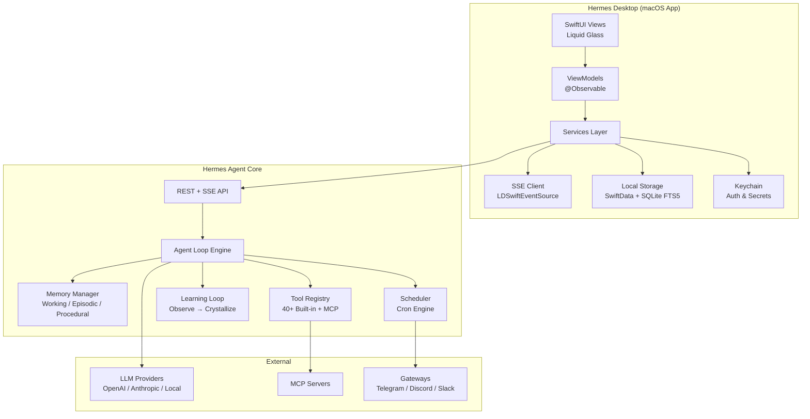
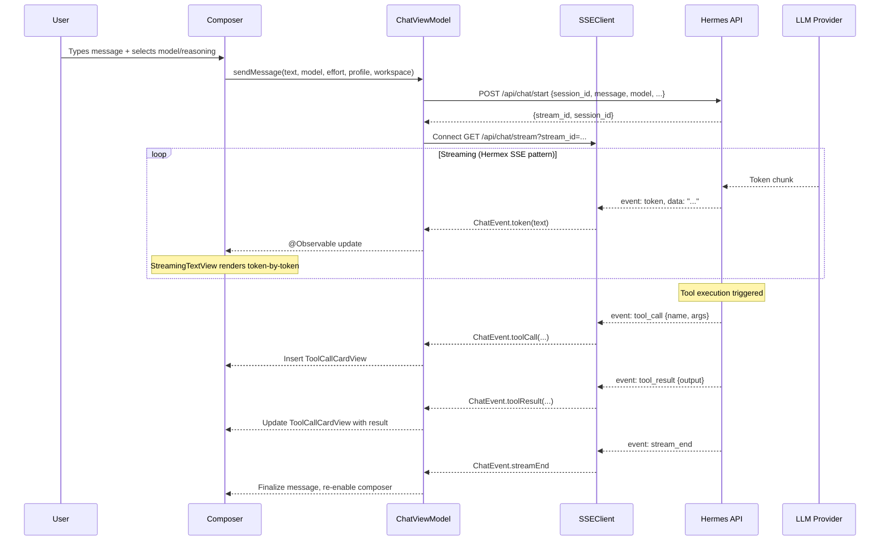

# Hermes Desktop for macOS — Swift / Xcode

> A native macOS desktop client for [Hermes Agent](https://github.com/nousresearch/hermes-agent), built with Swift & SwiftUI in Xcode. UI design inspired by [Hermex](https://github.com/uzairansaruzi/hermex) — adapted from mobile cockpit to desktop powerhouse. Embracing Apple's **Liquid Glass** material system on macOS 26 (Tahoe), optimized for **Apple Silicon M2+**.

---

## 0. Design Heritage

This project combines **two open-source references**:

| Source | What We Take |
|--------|-------------|
| [**Hermes Agent**](https://github.com/nousresearch/hermes-agent) (NousResearch) | All features — learning loop, 3-tier memory, 40+ tools, MCP, scheduling, multi-platform gateways, model-agnostic architecture |
| [**Hermex**](https://github.com/uzairansaruzi/hermex) (uzairansaruzi) | UI language — glass-forward panels, compact composer with runtime controls, dark-first aesthetic, dense native pickers, collapsible tool-call cards, streaming chat layout, session management UX |

Hermex is an iOS mobile cockpit for `hermes-webui`. We are **not** porting Hermex to macOS — we are building a **desktop-class application** that inherits Hermex's visual DNA while unlocking the full Hermes Agent feature set that only a desktop can support (multi-column layout, keyboard-driven workflows, local agent execution, Menu Bar integration, etc.).

---

## 1. Project Summary

### 1.1 What We're Building

A native macOS app (SwiftUI, macOS 26+, Apple Silicon M2+ only) that serves as both a **remote control plane** for a self-hosted Hermes Agent server AND a **local agent cockpit** capable of running the agent process directly on the Mac.

### 1.2 What It Is NOT

- ❌ Not an Electron or web wrapper
- ❌ Not a direct port of Hermex's iOS codebase to macOS
- ❌ Not a hosted service — every user brings their own server or runs locally
- ❌ Not a simple chatbot UI — it's a full agent management dashboard

### 1.3 Why It Exists

Hermex proves native SwiftUI beats web wrappers for agent interaction. But mobile is the control plane — desktop is where you **run** the agent, manage its memory, edit skills, configure gateways, and do real work alongside it. macOS with Liquid Glass provides the depth and translucency to make a complex dashboard feel lightweight and focused.

### 1.4 Product Mental Model

> **Hermex = iPhone remote control for an agent running elsewhere.**
> **Hermes Desktop = Mac command center where the agent lives and works.**

The Mac is both the compute plane AND the control plane. The desktop app manages the full lifecycle: starting the agent, streaming its work, browsing its memory, editing its skills, configuring its connections, and scheduling its automations.

---

## 2. Target Platform & Requirements

| Requirement | Value |
|-------------|-------|
| **Platform** | macOS 26 (Tahoe) or later |
| **Chip** | Apple Silicon M2+ only (arm64, no Intel support) |
| **IDE** | Xcode 27+ |
| **Language** | Swift 6.2 |
| **UI Framework** | SwiftUI with Liquid Glass materials |
| **Min RAM** | 8 GB (16 GB recommended for local model inference) |
| **Architecture** | arm64 only (no Universal Binary — M2+ exclusive) |

> [!NOTE]
> **Why M2+ only?** Hermes Agent benefits from the Neural Engine and increased memory bandwidth of M2 and later chips, especially when running local LLM inference. Dropping Intel and M1 simplifies Metal shaders, enables ProMotion-aware animations, and aligns with the macOS 26 Liquid Glass system requirements.

---

## 3. Hermes Agent — Feature Surface

All features from the [Hermes Agent](https://github.com/nousresearch/hermes-agent) must be exposed in the desktop app. The agent is described as *"the agent that grows with you"* — a long-lived, self-improving autonomous process.

### 3.1 Closed-Loop Learning System

After completing complex tasks, the agent reflects and distills successful workflows into reusable **Skills**. The desktop app must:

- Visualize the learning loop stages: **Observe → Execute → Reflect → Crystallize**
- Allow browsing, editing, testing, and sharing of crystallized skills
- Show skill version history and usage statistics

### 3.2 Persistent Memory (3-Tier)

| Tier | Purpose | Desktop Capabilities |
|------|---------|---------------------|
| **Working Memory** | Current session context | View & manage in real-time during chat |
| **Episodic Memory** | Cross-session facts, preferences | Full-text search, timeline view, graph visualization, manual edit/delete |
| **Procedural Memory** | Learned skills & workflows | Browse, edit, test, export, import |

### 3.3 Tool System (40+)

Built-in tools (web browsing, code execution, file operations) plus MCP (Model Context Protocol) integration. Desktop app provides:

- Tool registry browser with test playground
- MCP server connection management
- Real-time tool execution visualization in chat

### 3.4 Multi-Platform Communication Gateway

| Platform | Desktop Management |
|----------|-------------------|
| Telegram | Configure bot token, monitor messages |
| Discord | Bot token, server/channel selection |
| Slack | OAuth, workspace management |
| WhatsApp | Connection setup |
| Signal | Connection setup |
| Email | SMTP/IMAP configuration |
| CLI | Direct terminal integration |

### 3.5 Scheduled Automations

- Natural-language cron creation: *"Every morning at 9am, summarize my GitHub notifications"*
- Visual cron editor with calendar preview
- Execution history with results
- Delivery target selection (which gateway receives output)

### 3.6 Model Agnostic

Switch between LLM providers without reconfiguration:

- OpenAI (GPT-4, o1, etc.)
- Anthropic (Claude)
- OpenRouter
- Local models (Ollama, llama.cpp — leveraging M2+ Neural Engine)

---

## 4. Architecture

### 4.1 System Diagram



### 4.2 Layer Breakdown

| Layer | Responsibility | Technologies |
|-------|---------------|-------------|
| **Presentation** | SwiftUI views, Liquid Glass materials, animations | SwiftUI, `.glassEffect()`, `NavigationSplitView` |
| **ViewModel** | State management, user intent, data transforms | `@Observable`, Swift Concurrency |
| **Service** | API communication, SSE streaming, caching | `URLSession`, `LDSwiftEventSource`, `AsyncStream` |
| **Persistence** | Local cache, settings, skill files | SwiftData, SQLite FTS5, `FileManager` |
| **Auth** | Server URL, password, cookies, API keys | Keychain via `Security` framework |
| **Agent Bridge** | Connection to Hermes Agent (local or remote) | REST + SSE client, health monitoring |

### 4.3 Connection Modes

Following Hermex's client-server model but expanded for desktop:

| Mode | Description |
|------|-------------|
| **Local** | Agent runs on the same Mac; app connects to `localhost:8787` |
| **Tunnel** | Agent on remote server via Cloudflare Tunnel or reverse proxy (HTTPS) |
| **Tailscale** | Agent on a Tailnet peer device; plain HTTP allowed on `100.64.0.0/10` |

---

## 5. UI Design System — Hermex × Liquid Glass

> [!IMPORTANT]
> The UI takes direct inspiration from [Hermex](https://github.com/uzairansaruzi/hermex): **glass-forward panels**, **dark-first aesthetic**, **compact composer with runtime controls**, and **dense native pickers**. These mobile patterns are adapted to a multi-column desktop layout using Apple's Liquid Glass material system on macOS 26.

### 5.1 Design Principles (from Hermex, adapted for desktop)

| Principle | Hermex (Mobile) | Hermes Desktop (Mac) |
|-----------|-----------------|---------------------|
| **Glass-forward** | `.ultraThinMaterial` on cards and panels | Liquid Glass `.glassEffect()` on sidebar, toolbar, detail panels |
| **Dark-first** | Optimized for dark mode to reduce eye strain | Default dark appearance; light mode supported but secondary |
| **Compact controls** | Composer has inline model/reasoning selectors | Expanded composer bar with model picker, reasoning effort, profile, workspace — all in one glass surface |
| **Dense pickers** | Native, scan-friendly model/profile pickers | Keyboard-navigable, search-enabled pickers in popovers |
| **Content focus** | Agent output is the hero, controls are peripheral | Three-column layout keeps conversation center-stage |
| **No 3rd-party UI** | Pure SwiftUI, no external UI packages | Pure SwiftUI + system Liquid Glass APIs |

### 5.2 Color Palette

```
┌───────────────────────────────────────────────────────┐
│  HERMES DESKTOP — COLOR PALETTE                       │
│  (Hermex-inspired, Liquid Glass adapted)              │
├───────────────────────────────────────────────────────┤
│                                                       │
│  ● Accent Primary    #7C5CFC  (Hermes Purple)        │
│  ● Accent Secondary  #00D4AA  (Teal — active/online) │
│  ● Accent Warm       #FF6B6B  (Error / destructive)  │
│  ● Accent Amber      #FFB347  (Warning / scheduled)  │
│  ● Accent Blue       #4A9EFF  (Info / links)         │
│                                                       │
│  Glass Tint (Dark)   rgba(20, 20, 30, 0.72)          │
│  Glass Tint (Light)  rgba(250, 250, 255, 0.60)       │
│                                                       │
│  Surface Dark        #0D0D14  (Main background)      │
│  Surface Elevated     #1A1A2E  (Cards, panels)       │
│  Surface Glass        system .ultraThinMaterial       │
│                                                       │
│  Text Primary        .label  (system adaptive)       │
│  Text Secondary      .secondaryLabel                  │
│  Text Tertiary       .tertiaryLabel                   │
│  Text Code           SF Mono + custom syntax colors   │
│                                                       │
└───────────────────────────────────────────────────────┘
```

### 5.3 Typography

Following Hermex's native font approach, scaled for desktop:

| Element | Font | Size | Weight |
|---------|------|------|--------|
| Window Title | SF Pro Display | 20pt | Semibold |
| Sidebar Section | SF Pro Display | 13pt | Medium |
| Sidebar Session Row | SF Pro Text | 14pt | Regular |
| Chat Body | SF Pro Text | 14pt | Regular |
| Code Blocks | SF Mono | 13pt | Regular |
| Composer Text | SF Pro Text | 15pt | Regular |
| Composer Controls | SF Pro Text | 12pt | Medium |
| Tool Call Title | SF Pro Text | 13pt | Semibold |
| Timestamp / Caption | SF Pro Text | 11pt | Light |
| Badge / Status | SF Pro Rounded | 11pt | Medium |

### 5.4 Component Mapping — Hermex → Desktop

| Hermex Component | Desktop Adaptation |
|------------------|-------------------|
| **Session list** (full-screen) | Left sidebar column in `NavigationSplitView` with Liquid Glass material |
| **Chat view** (full-screen, stacked) | Center content column — wider, with persistent compose bar |
| **Composer** (bottom bar with model/reasoning row) | Bottom glass surface — full-width compose area with inline controls for model, reasoning, profile, workspace, and attachments |
| **Model picker** (bottom sheet) | Popover from composer — searchable, with recents and favorites |
| **Tool call cards** (collapsible inline) | Expandable glass cards inline in chat — wider with side-by-side input/output |
| **Thinking blocks** (collapsible) | Collapsible glass panel with "Reasoning" header and SF Symbol icon |
| **Sessions / Tasks / Skills / Memory / Insights tabs** | Tabbed detail panel (right column) OR top-level navigation tabs in sidebar |
| **File browser** (pushed view) | Split detail panel or popover drawer |
| **Settings** (pushed view) | Native `Settings` scene with tabbed panes |
| **Streaming text** | Token-by-token render with cursor animation |

---

## 6. App Layout & Screens

### 6.1 Main Window — Three-Column Layout

Adapted from Hermex's single-column mobile navigation into a desktop-class three-column `NavigationSplitView`:

```
┌──────────────────────────────────────────────────────────────────────────┐
│  ◉ ◉ ◉    Hermes Desktop                     ⚙ Model: Claude 3.5 ◻    │
│  ══════════════════════════ Liquid Glass Toolbar ═══════════════════════  │
│  ┌─────────────┐  ┌───────────────────────────────────┐  ┌───────────┐ │
│  │ SIDEBAR     │  │  C O N V E R S A T I O N         │  │  DETAIL   │ │
│  │ Glass Panel │  │                                   │  │  PANEL    │ │
│  │             │  │  ┌──────────────────────────────┐ │  │           │ │
│  │ 🔍 Search   │  │  │ 🤖 Hermes            2:34 PM│ │  │  ⊞ Tabs  │ │
│  │             │  │  │ I've analyzed the codebase   │ │  │ ┌───────┐ │ │
│  │ ★ Pinned    │  │  │ and found 3 issues...        │ │  │ │Memory │ │ │
│  │  ┌────────┐ │  │  │                              │ │  │ │Skills │ │ │
│  │  │Chat α  │ │  │  │ ┌─ ⚡ tool: code_analysis ─┐│ │  │ │Tools  │ │ │
│  │  │Chat β  │ │  │  │ │ Status: ✅ (1.2s)        ││ │  │ │Tasks  │ │ │
│  │  └────────┘ │  │  │ │ ▶ Show result            ││ │  │ │Insight│ │ │
│  │             │  │  │ └──────────────────────────┘│ │  │ │Files  │ │ │
│  │ 📁 Recent   │  │  └──────────────────────────────┘ │  │ └───────┘ │ │
│  │  ┌────────┐ │  │                                   │  │           │ │
│  │  │Chat γ  │ │  │  ┌──────────────────────────────┐ │  │ Memory   │ │
│  │  │Chat δ  │ │  │  │ 👤 You               2:35 PM│ │  │ ┌───────┐ │ │
│  │  │Chat ε  │ │  │  │ Refactor the auth module     │ │  │ │2,412  │ │ │
│  │  └────────┘ │  │  │ and add proper error handling │ │  │ │entries│ │ │
│  │             │  │  └──────────────────────────────┘ │  │ └───────┘ │ │
│  │ 📂 Projects │  │                                   │  │           │ │
│  │  ┌────────┐ │  │  ┌──────────────────────────────┐ │  │ Skills   │ │
│  │  │Backend │ │  │  │ 🤖 Hermes         ● typing..│ │  │ ┌───────┐ │ │
│  │  │DevOps  │ │  │  │ ▌ (streaming cursor)         │ │  │ │  12   │ │ │
│  │  └────────┘ │  │  └──────────────────────────────┘ │  │ │active │ │ │
│  │             │  │                                   │  │ └───────┘ │ │
│  │ ⏰ Tasks    │  │  ═══ Composer Bar (Glass) ════════│  │           │ │
│  │  Daily 9am  │  │  ┌──────────────────────────────┐ │  │ Gateway  │ │
│  │  Backup 2am │  │  │ 💬 Message Hermes...    📎 ▶ │ │  │ 🟢 Tg   │ │
│  │             │  │  │ ┌──────────────────────────┐ │ │  │ 🟢 Dc   │ │
│  │ ● Connected │  │  │ │Claude 3.5│Med│Default│~/│ │ │  │ 🟡 Sl   │ │
│  │   local     │  │  │ └──────────────────────────┘ │ │  │           │ │
│  └─────────────┘  │  └──────────────────────────────┘ │  └───────────┘ │
│  ══════════════════ Status Bar (Glass) ═════════════════════════════════ │
│  ● Connected to Hermes Core (localhost:8787)    Memory: 2.4k │ M2 Pro  │
└──────────────────────────────────────────────────────────────────────────┘
```

### 6.2 Composer Bar — Hermex-Style with Desktop Expansion

The composer directly follows Hermex's design: a **single glass surface** with the prompt area on top and runtime controls on the bottom row. Adapted for desktop with more controls visible:

```
┌─────────────────────────────────────────────────────────────────┐
│  📎 Attach                                              ▶ Send  │
│  ┌─────────────────────────────────────────────────────────┐   │
│  │ Message Hermes...                                       │   │
│  │                                                         │   │
│  └─────────────────────────────────────────────────────────┘   │
│  ┌───────────┐ ┌─────────┐ ┌──────────┐ ┌────────┐ ┌──────┐  │
│  │🤖 Claude  │ │⚡Medium │ │👤 Default│ │📂 ~/dev│ │/cmd ▾│  │
│  │  3.5 Son ▾│ │ effort ▾│ │ profile ▾│ │  space▾│ │      │  │
│  └───────────┘ └─────────┘ └──────────┘ └────────┘ └──────┘  │
└─────────────────────────────────────────────────────────────────┘
  Model Picker   Reasoning   Profile     Workspace   Slash Cmd
```

**Controls row** (Hermex-style inline selectors, expanded for desktop):

| Control | Hermex Equivalent | Desktop Behavior |
|---------|-------------------|-----------------|
| **Model Picker** | Bottom-sheet model selector | Popover with search, recents, favorites, provider grouping |
| **Reasoning Effort** | SF Symbol toggle (low/med/high) | Segmented control with icons: 💡 Low, ⚡ Medium, 🧠 High |
| **Profile** | Profile switcher | Popover with profile list |
| **Workspace** | Workspace path | Popover with path autocomplete via `/api/workspaces/suggest` |
| **Slash Commands** | — | Dropdown with `/cmd` suggestions from `/api/commands` |

### 6.3 Screen Inventory

| Screen | Hermex Equivalent | Desktop Adaptation |
|--------|-------------------|-------------------|
| **Onboarding** | Server URL + password form | Same — first-run setup with connection test |
| **Session List (Sidebar)** | Full-screen session list with search, pin, archive | Persistent sidebar column with grouped sections (Pinned, Today, Yesterday, Projects, Tasks) |
| **Conversation** | Full-screen chat with streaming | Center column — wide streaming chat with inline tool cards |
| **Composer** | Bottom bar with model/reasoning row | Bottom glass bar with expanded controls row |
| **Detail Panel** | — (mobile has no persistent detail) | Right column with tabbed panels: Memory, Skills, Tools, Tasks, Insights, Files |
| **Tasks** | Read-only cron jobs list | Full CRUD: create, edit, pause, resume, delete scheduled tasks |
| **Skills** | Read-only skills catalog + detail | Full management: browse, edit, test, export, import, version history |
| **Memory** | Read-only notes + user profile | Full management: FTS5 search, timeline, graph view, edit/delete |
| **Insights** | Limited session-based analytics | Usage analytics dashboard with charts and cost tracking |
| **Workspace Browser** | Pushed tree view with breadcrumbs | Split detail panel with tree navigation and file preview |
| **Tool Registry** | — | Browse built-in + MCP tools, test playground |
| **Gateway Manager** | — | Configure messaging platform connections |
| **Settings** | Pushed settings view | Native macOS `Settings` scene with tabbed panes |

### 6.4 Chat Messages — Hermex Style

Following Hermex's message rendering:

```
┌─ Assistant Message ──────────────────────────────────────────┐
│  🤖 Hermes                                        2:34 PM   │
│                                                              │
│  I've analyzed your codebase and found the following:        │
│                                                              │
│  ┌─ ⚡ tool_call: code_analysis ───────────────────────────┐ │
│  │  Status: ✅ Complete (1.2s)                              │ │
│  │                                                          │ │
│  │  ▶ Input                        ▶ Result                │ │
│  │  ┌─────────────────┐            ┌─────────────────────┐ │ │
│  │  │ path: "./src"   │            │ issues: 3           │ │ │
│  │  │ depth: 3        │            │ warnings: 12        │ │ │
│  │  └─────────────────┘            │ files_scanned: 47   │ │ │
│  │                                 └─────────────────────┘ │ │
│  └──────────────────────────────────────────────────────────┘ │
│                                                              │
│  Here's a summary of the 3 critical issues:                  │
│                                                              │
│  ```swift                                                    │
│  // Issue 1: Force unwrap in AuthManager.swift:42            │
│  let token = keychain.get("token")! // ← crash risk         │
│  ```                                                         │
│                                                              │
└──────────────────────────────────────────────────────────────┘

┌─ User Message ──────────────────────────────────────────────┐
│                                              👤 You  2:35 PM│
│                                                              │
│  Can you fix all 3 issues and add proper error handling?     │
│                                                              │
│  📄 auth_module.swift (attached)                             │
│                                                              │
└──────────────────────────────────────────────────────────────┘

┌─ Thinking Block (Collapsible) ──────────────────────────────┐
│  🧠 Reasoning...                                     ▼ Hide │
│  ┌──────────────────────────────────────────────────────────┐│
│  │ I need to examine the force unwraps in AuthManager and  ││
│  │ replace them with proper optional handling. Let me also  ││
│  │ check for other potential crash points...                ││
│  └──────────────────────────────────────────────────────────┘│
└──────────────────────────────────────────────────────────────┘
```

---

## 7. Xcode Project Structure

Directly modeled after Hermex's file layout from [PROJECT_SPEC.md](https://github.com/uzairansaruzi/hermex/blob/master/PROJECT_SPEC.md), but adapted for macOS scope:

```
HermesDesktop/
├── HermesDesktop.xcodeproj
├── PROJECT_SPEC.md                          # This document
├── DEVELOPMENT.md                           # Dev setup & workflow
├── CHANGELOG.md
├── CONTRIBUTING.md
│
├── HermesDesktop/
│   ├── HermesDesktopApp.swift               # @main entry point
│   │
│   ├── Config/
│   │   └── AppConfig.swift                  # Build constants, log subsystems
│   │
│   ├── Networking/
│   │   ├── APIClient.swift                  # actor wrapping URLSession
│   │   ├── APIError.swift                   # .network, .http, .decoding, .unauthorized
│   │   ├── Endpoints.swift                  # One func per endpoint (§6 of Hermex spec)
│   │   ├── SSEClient.swift                  # Wraps LDSwiftEventSource
│   │   └── ChatStream.swift                 # AsyncSequence of ChatEvent
│   │
│   ├── Models/
│   │   ├── Session.swift                    # Codable, matches server JSON
│   │   ├── ChatMessage.swift
│   │   ├── ChatEvent.swift                  # Decoded SSE payload variants
│   │   ├── ToolCall.swift
│   │   ├── Memory.swift                     # Memory entry model
│   │   ├── Skill.swift                      # Skill definition + version
│   │   ├── Schedule.swift                   # Cron job model
│   │   ├── Gateway.swift                    # Messaging gateway config
│   │   ├── WorkspaceEntry.swift
│   │   ├── Project.swift                    # Session project grouping
│   │   └── ServerInfo.swift
│   │
│   ├── Persistence/
│   │   ├── CacheStore.swift                 # SwiftData @Model types
│   │   ├── CachedSession.swift
│   │   ├── CachedMessage.swift
│   │   └── LocalMemoryStore.swift           # SQLite FTS5 for memory search
│   │
│   ├── Auth/
│   │   ├── KeychainStore.swift              # save/load/delete — Security framework
│   │   └── AuthManager.swift                # @Observable: .unconfigured|.loggedOut|.loggedIn
│   │
│   ├── Features/
│   │   ├── Onboarding/
│   │   │   ├── OnboardingView.swift         # Server URL + password (Hermex-style)
│   │   │   └── OnboardingViewModel.swift
│   │   │
│   │   ├── Sidebar/
│   │   │   ├── SidebarView.swift            # Session list with sections
│   │   │   ├── SessionRowView.swift         # Compact row with title, preview, timestamp
│   │   │   ├── ProjectGroupView.swift       # Collapsible project folders
│   │   │   └── SidebarViewModel.swift
│   │   │
│   │   ├── Chat/
│   │   │   ├── ChatView.swift               # Center column conversation
│   │   │   ├── ChatViewModel.swift          # SSE streaming, message management
│   │   │   ├── MessageBubbleView.swift      # Hermex-style bubbles
│   │   │   ├── ToolCallCardView.swift       # Collapsible glass tool cards
│   │   │   ├── ThinkingBlockView.swift      # Collapsible reasoning panel
│   │   │   ├── CodeBlockView.swift          # Syntax-highlighted with copy button
│   │   │   ├── StreamingTextView.swift      # Token-by-token renderer
│   │   │   └── MarkdownRenderer.swift       # swift-markdown-ui config
│   │   │
│   │   ├── Composer/
│   │   │   ├── ComposerBarView.swift        # Hermex-style glass composer
│   │   │   ├── ModelPickerView.swift         # Popover — search, recents, favorites
│   │   │   ├── ReasoningSelector.swift       # SF Symbol segmented control
│   │   │   ├── ProfilePickerView.swift       # Popover profile list
│   │   │   ├── WorkspacePickerView.swift     # Path autocomplete popover
│   │   │   └── AttachmentBar.swift           # File/image attachment strip
│   │   │
│   │   ├── Detail/
│   │   │   ├── DetailPanelView.swift         # Right column with tabs
│   │   │   ├── MemoryTabView.swift           # FTS5 search, timeline, graph
│   │   │   ├── SkillsTabView.swift           # Browse, edit, test skills
│   │   │   ├── ToolsTabView.swift            # Tool registry + MCP
│   │   │   ├── TasksTabView.swift            # Scheduled cron jobs
│   │   │   ├── InsightsTabView.swift         # Usage analytics
│   │   │   └── FilesTabView.swift            # Workspace file browser
│   │   │
│   │   ├── Memory/
│   │   │   ├── MemoryBrowserView.swift       # Full-screen memory explorer
│   │   │   ├── MemoryEntryRow.swift
│   │   │   ├── MemoryGraphView.swift         # Entity relationship visualization
│   │   │   ├── MemoryTimelineView.swift
│   │   │   └── MemoryViewModel.swift
│   │   │
│   │   ├── Skills/
│   │   │   ├── SkillsManagerView.swift       # Full management UI
│   │   │   ├── SkillCardView.swift           # Glass card with usage stats
│   │   │   ├── SkillEditorView.swift         # Edit skill definition
│   │   │   ├── LearningLoopView.swift        # Visualize learning stages
│   │   │   └── SkillsViewModel.swift
│   │   │
│   │   ├── Tasks/
│   │   │   ├── SchedulerView.swift           # Full CRUD task management
│   │   │   ├── ScheduleRowView.swift
│   │   │   ├── CronEditorView.swift          # Visual cron builder
│   │   │   ├── TaskOutputView.swift          # Recent execution results
│   │   │   └── SchedulerViewModel.swift
│   │   │
│   │   ├── Gateway/
│   │   │   ├── GatewayManagerView.swift      # All platform connections
│   │   │   ├── PlatformConfigSheet.swift     # Per-platform setup sheet
│   │   │   └── GatewayViewModel.swift
│   │   │
│   │   ├── Tools/
│   │   │   ├── ToolRegistryView.swift        # Browse all tools
│   │   │   ├── ToolDetailView.swift          # Tool info + test playground
│   │   │   ├── MCPServerConfigView.swift     # MCP connection management
│   │   │   └── ToolsViewModel.swift
│   │   │
│   │   └── Settings/
│   │       ├── SettingsView.swift            # macOS Settings scene
│   │       ├── ConnectionPane.swift          # Server URL, health check
│   │       ├── LLMProviderPane.swift         # Model provider configuration
│   │       ├── AppearancePane.swift          # Theme, colors, glass intensity
│   │       ├── SandboxPane.swift             # Execution backend config
│   │       └── AboutPane.swift               # Version, server compat, cache
│   │
│   ├── DesignSystem/
│   │   ├── HermesColors.swift                # Palette from §5.2
│   │   ├── HermesTypography.swift            # Font styles from §5.3
│   │   ├── HermesSpacing.swift               # Layout constants
│   │   └── Components/
│   │       ├── GlassCard.swift               # Reusable Liquid Glass card
│   │       ├── GlassToolbar.swift            # Custom glass toolbar
│   │       ├── GlassStatusBar.swift          # Bottom status indicator
│   │       ├── PulsingDot.swift              # Connection status animation
│   │       ├── ShimmerView.swift             # Loading skeleton
│   │       ├── EmptyStateView.swift          # Hermex-style empty states
│   │       └── ErrorBanner.swift             # Inline error display
│   │
│   ├── Extensions/
│   │   ├── View+Glass.swift                  # .hermesGlassCard() modifier
│   │   ├── Color+Hermes.swift                # Named color accessors
│   │   ├── String+Markdown.swift             # Markdown helpers
│   │   └── Date+Relative.swift               # "2m ago", "Yesterday"
│   │
│   └── Resources/
│       ├── Assets.xcassets/
│       │   ├── AppIcon.appiconset/
│       │   ├── AccentColor.colorset/
│       │   └── HermesColors/                 # Full palette as color sets
│       ├── Localizable.xcstrings
│       └── HermesDesktop.entitlements
│
├── HermesDesktopTests/
│   ├── Networking/
│   │   ├── APIClientTests.swift              # URLProtocol-based mock tests
│   │   ├── SSEParsingTests.swift
│   │   └── EndpointsTests.swift
│   ├── ViewModels/
│   │   ├── ChatViewModelTests.swift
│   │   ├── SidebarViewModelTests.swift
│   │   └── SchedulerViewModelTests.swift
│   └── Mocks/
│       ├── MockAPIClient.swift
│       └── MockURLProtocol.swift
│
├── HermesDesktopUITests/
│   ├── OnboardingFlowTests.swift
│   ├── ChatFlowTests.swift
│   └── MemoryBrowserTests.swift
│
├── HermesMenuBarWidget/                      # Menu Bar Extra target
│   ├── MenuBarView.swift
│   └── QuickChatView.swift
│
└── HermesWidgets/                            # WidgetKit target
    ├── AgentStatusWidget.swift
    └── RecentMemoryWidget.swift
```

---

## 8. Key Implementation — Code Samples

### 8.1 App Entry Point

```swift
import SwiftUI

@main
struct HermesDesktopApp: App {
    @State private var authManager = AuthManager()
    
    var body: some Scene {
        WindowGroup {
            Group {
                if authManager.state == .unconfigured {
                    OnboardingView()
                } else {
                    ContentView()
                }
            }
            .environment(authManager)
        }
        .windowStyle(.automatic)           // Liquid Glass window chrome
        .windowToolbarStyle(.unified)
        
        Settings {
            SettingsView()
                .environment(authManager)
        }
        
        // Hermex doesn't have this — desktop exclusive
        MenuBarExtra("Hermes", systemImage: "brain.head.profile") {
            MenuBarView()
                .environment(authManager)
        }
        .menuBarExtraStyle(.window)
    }
}
```

### 8.2 Three-Column Layout (Hermex → Desktop)

```swift
struct ContentView: View {
    @Environment(AuthManager.self) var auth
    @State private var selectedSession: Session?
    @State private var columnVisibility: NavigationSplitViewVisibility = .all
    
    var body: some View {
        NavigationSplitView(columnVisibility: $columnVisibility) {
            // LEFT: Hermex session list → persistent sidebar
            SidebarView(selection: $selectedSession)
        } content: {
            // CENTER: Hermex chat view → wide conversation area
            if let session = selectedSession {
                ChatView(session: session)
            } else {
                WelcomeView()
            }
        } detail: {
            // RIGHT: Desktop-exclusive detail panel
            if let session = selectedSession {
                DetailPanelView(session: session)
            }
        }
        .navigationSplitViewStyle(.balanced)
    }
}
```

### 8.3 Hermex-Style Composer Bar

```swift
struct ComposerBarView: View {
    @Binding var messageText: String
    @State private var selectedModel: LLMModel?
    @State private var reasoningEffort: ReasoningEffort = .medium
    @State private var selectedProfile: Profile?
    @State private var selectedWorkspace: String = "~/"
    
    var onSend: (String) -> Void
    var onAttach: () -> Void
    
    var body: some View {
        VStack(spacing: 8) {
            // Prompt area
            HStack(alignment: .bottom) {
                Button(action: onAttach) {
                    Image(systemName: "paperclip")
                }
                
                TextField("Message Hermes...", text: $messageText, axis: .vertical)
                    .textFieldStyle(.plain)
                    .lineLimit(1...8)
                
                Button(action: { onSend(messageText) }) {
                    Image(systemName: "arrow.up.circle.fill")
                        .font(.title2)
                        .foregroundStyle(.hermesPurple)
                }
                .disabled(messageText.trimmingCharacters(in: .whitespaces).isEmpty)
            }
            
            // Hermex-style runtime controls row
            HStack(spacing: 12) {
                ModelPickerButton(selection: $selectedModel)
                ReasoningSelector(effort: $reasoningEffort)
                ProfilePickerButton(selection: $selectedProfile)
                WorkspacePickerButton(path: $selectedWorkspace)
                Spacer()
                SlashCommandMenu()
            }
            .font(.caption)
        }
        .padding(12)
        .glassEffect()   // Liquid Glass material
    }
}
```

### 8.4 SSE Streaming (Hermex Pattern → macOS)

Following Hermex's SSE approach using `LDSwiftEventSource`:

```swift
import LDSwiftEventSource

actor ChatStreamManager {
    private var eventSource: EventSource?
    
    func startStream(
        baseURL: URL,
        streamID: String,
        cookies: [HTTPCookie]
    ) -> AsyncStream<ChatEvent> {
        AsyncStream { continuation in
            var config = EventSource.Config(
                handler: StreamHandler(continuation: continuation),
                url: baseURL.appendingPathComponent("api/chat/stream")
                    .appending(queryItems: [.init(name: "stream_id", value: streamID)])
            )
            
            // Apply auth cookies
            let headers = HTTPCookie.requestHeaderFields(with: cookies)
            config.headers = headers
            
            eventSource = EventSource(config: config)
            eventSource?.start()
            
            continuation.onTermination = { [weak self] _ in
                Task { await self?.eventSource?.stop() }
            }
        }
    }
}

// SSE event types from Hermex's ChatEvent model
enum ChatEvent: Decodable {
    case token(String)
    case toolCall(ToolCallEvent)
    case toolResult(ToolResultEvent)
    case reasoning(String)
    case streamEnd
    case error(String)
    case cancel
}
```

### 8.5 Liquid Glass Components

```swift
import SwiftUI

// Hermex's glass card adapted for macOS Liquid Glass
struct GlassCard<Content: View>: View {
    let content: Content
    var cornerRadius: CGFloat = 12
    
    init(cornerRadius: CGFloat = 12, @ViewBuilder content: () -> Content) {
        self.content = content()
        self.cornerRadius = cornerRadius
    }
    
    var body: some View {
        content
            .padding(12)
            .background {
                RoundedRectangle(cornerRadius: cornerRadius)
                    .fill(.ultraThinMaterial)
                    .glassEffect()         // macOS 26 Liquid Glass
            }
            .overlay {
                RoundedRectangle(cornerRadius: cornerRadius)
                    .stroke(Color.white.opacity(0.12), lineWidth: 0.5)
            }
    }
}

// Hermex-style tool call card with Liquid Glass
struct ToolCallCardView: View {
    let toolCall: ToolCallEvent
    @State private var isExpanded = false
    
    var body: some View {
        GlassCard(cornerRadius: 10) {
            VStack(alignment: .leading, spacing: 8) {
                HStack {
                    Image(systemName: "bolt.fill")
                        .foregroundStyle(.hermesAmber)
                    Text("tool: \(toolCall.name)")
                        .font(.hermes(.toolCallTitle))
                    Spacer()
                    StatusBadge(status: toolCall.status)
                    Image(systemName: isExpanded ? "chevron.up" : "chevron.down")
                }
                .contentShape(Rectangle())
                .onTapGesture { withAnimation(.spring()) { isExpanded.toggle() } }
                
                if isExpanded {
                    Divider()
                    HStack(alignment: .top, spacing: 16) {
                        // Side-by-side input/output (desktop width advantage)
                        VStack(alignment: .leading) {
                            Text("Input").font(.caption).foregroundStyle(.secondary)
                            CodeBlockView(code: toolCall.inputJSON, language: "json")
                        }
                        VStack(alignment: .leading) {
                            Text("Result").font(.caption).foregroundStyle(.secondary)
                            CodeBlockView(code: toolCall.resultJSON ?? "...", language: "json")
                        }
                    }
                }
            }
        }
    }
}
```

---

## 9. macOS Platform Integration

Desktop-exclusive features that go beyond Hermex's mobile scope:

| Feature | Implementation |
|---------|---------------|
| **Menu Bar Extra** | Always-available quick-chat window from menu bar |
| **Keyboard Shortcuts** | `⌘N` new chat, `⌘K` command palette, `⌘⇧M` memory, `⌘.` stop stream |
| **Spotlight** | Index memory entries via Core Spotlight for system-wide search |
| **Notifications** | `UNUserNotificationCenter` for scheduled task results and gateway messages |
| **Drag & Drop** | Drop files/images into composer or chat area |
| **Share Extension** | Share content from any app → "Send to Hermes" |
| **Quick Actions** | Finder right-click → "Ask Hermes About This" |
| **WidgetKit** | Agent status widget and recent memories widget |
| **Handoff** | Continue conversation from Hermex on iPhone (future) |
| **Touch Bar** | Quick actions for older MacBook Pro models |

---

## 10. Data Flow



---

## 11. Tech Stack (Locked)

Following Hermex's strict dependency policy:

| Layer | Choice | Why |
|-------|--------|-----|
| UI Framework | **SwiftUI** | Modern, Liquid Glass native support |
| Min macOS | **26.0 (Tahoe)** | Required for Liquid Glass `.glassEffect()` |
| Networking | **`URLSession` (built-in)** | No third-party dependency needed |
| SSE Client | **[LDSwiftEventSource](https://github.com/launchdarkly/swift-eventsource)** | Same as Hermex — best-maintained Swift SSE library |
| Markdown | **[swift-markdown-ui](https://github.com/gonzalezreal/swift-markdown-ui)** | Same as Hermex — mature, themeable |
| Syntax Highlighting | **[Splash](https://github.com/JohnSundell/Splash)** + **[Highlightr](https://github.com/raspu/Highlightr)** | Same as Hermex |
| Local Cache | **SwiftData** | Native, sufficient for session/message cache |
| Memory Store | **SQLite (FTS5)** | Full-text search for agent memory (desktop-only, beyond Hermex's read-only) |
| Secrets | **Keychain** via `Security` framework | Same pattern as Hermex's `KeychainStore` |
| Logging | **`OSLog`** | Built-in, Console.app compatible |
| Testing | **XCTest** + `URLProtocol` mocks | Same as Hermex — no third-party test framework |

> [!WARNING]
> **Do NOT add dependencies** beyond this list without explicit approval. This matches Hermex's strict dependency policy.

---

## 12. Security & Privacy

Following Hermex's privacy-first approach:

| Concern | Mitigation |
|---------|------------|
| **Password/Token** | Stored in macOS Keychain, never in UserDefaults or plain files |
| **Server URL** | Also stored in Keychain (it's effectively a credential when combined with password) |
| **Auth Cookie** | Managed via `URLSession.shared.configuration.httpCookieStorage` |
| **No Analytics** | Zero third-party analytics, tracking, or telemetry (matching Hermex's policy) |
| **No Middleman** | App talks only to user's own server — no relay service |
| **CSRF** | Omit `Origin` and `Referer` headers on POST requests (curl-equivalent path) |
| **App Sandbox** | Enabled with minimal entitlements |
| **Memory Data** | SQLite encrypted at rest via macOS FileVault |
| **On 401** | Clear cookie and redirect to Onboarding |

---

## 13. Build & Run

### Prerequisites

```bash
# Requires Apple Silicon M2+ Mac running macOS 26 (Tahoe)
# Requires Xcode 27+

git clone https://github.com/your-org/hermes-desktop-macos.git
cd hermes-desktop-macos
open HermesDesktop.xcodeproj
```

### Build from command line

```bash
xcodebuild -project HermesDesktop.xcodeproj \
    -scheme HermesDesktop \
    -destination 'platform=macOS' \
    build
```

### Run tests

```bash
xcodebuild test -project HermesDesktop.xcodeproj \
    -scheme HermesDesktop \
    -destination 'platform=macOS'
```

### Environment

```
HERMES_API_URL=http://localhost:8787      # Local Hermes server
HERMES_ENV=development                     # Debug flag
```

---

## 14. Build Plan (Phased)

Each phase ends in a working, committable state. Run on M2+ Mac after every phase.

### Phase 0 — Setup (½ day)
- [ ] Create Xcode project: SwiftUI App, macOS 26+, Swift 6.2, target `HermesDesktop`
- [ ] Add SPM dependencies: LDSwiftEventSource, swift-markdown-ui, Splash, Highlightr
- [ ] Add `.gitignore`, `README.md`, `PROJECT_SPEC.md`, `DEVELOPMENT.md`
- [ ] Configure entitlements and App Sandbox

### Phase 1 — Onboarding + Auth (1–2 days)
- [ ] `KeychainStore`: save/load/delete wrapper
- [ ] `AuthManager` (`@Observable`): `.unconfigured | .loggedOut | .loggedIn`
- [ ] `OnboardingView`: Server URL + password form (Hermex-style)
- [ ] "Test connection" → `GET /health`
- [ ] Cookie-based auth via `POST /api/auth/login`

### Phase 2 — Networking Core (2–3 days)
- [ ] `APIClient` actor with cookie-configured `URLSession`
- [ ] `Endpoints.swift`: typed functions for all API surface
- [ ] `Codable` models with tolerant decoding (optionals everywhere)
- [ ] Error handling with 401 → bounce to Onboarding
- [ ] URLProtocol-based mock tests

### Phase 3 — Sidebar + Session List (2 days)
- [ ] `SidebarView` in `NavigationSplitView` left column
- [ ] Grouped sections: Pinned, Today, Yesterday, Earlier, Projects
- [ ] Search, context menu (pin/archive/delete/move/duplicate)
- [ ] "+" button → create session
- [ ] Empty state

### Phase 4 — Chat + SSE Streaming (4–6 days)
- [ ] `ChatView` center column with message list
- [ ] `ComposerBarView` (Hermex-style glass composer with controls row)
- [ ] `MessageBubbleView` for user and assistant messages
- [ ] `ToolCallCardView` (collapsible glass cards)
- [ ] `ThinkingBlockView` (collapsible reasoning)
- [ ] SSE streaming with token-by-token rendering
- [ ] Stop/cancel button
- [ ] Steer command during active stream
- [ ] Background/foreground stream reconnection

### Phase 5 — Detail Panel (3–4 days)
- [ ] `DetailPanelView` in right column with tabs
- [ ] Memory tab: FTS5 search, timeline view
- [ ] Skills tab: browse, detail view
- [ ] Tools tab: registry browser
- [ ] Tasks tab: cron jobs list
- [ ] Insights tab: usage analytics
- [ ] Files tab: workspace browser

### Phase 6 — Desktop Integrations (2–3 days)
- [ ] Menu Bar Extra with quick chat
- [ ] Keyboard shortcuts (`⌘N`, `⌘K`, `⌘.`, etc.)
- [ ] macOS notifications for task completions
- [ ] Drag & drop file attachments
- [ ] Native Settings scene with tabbed panes

### Phase 7 — Advanced Features (3–4 days)
- [ ] Full memory management (edit, delete, graph view)
- [ ] Full skills management (edit, test, export, import)
- [ ] Full scheduler (create, edit, pause, resume, delete)
- [ ] Gateway manager (platform connections)
- [ ] MCP server configuration

### Phase 8 — Offline Cache (1–2 days)
- [ ] SwiftData schema: `CachedSession`, `CachedMessage`
- [ ] Write-through cache on every fetch
- [ ] Offline banner + disabled composer
- [ ] TTL-based cache eviction

### Phase 9 — Polish & Distribution (2–3 days)
- [ ] Spotlight integration for memory entries
- [ ] WidgetKit widgets
- [ ] Share Extension
- [ ] Performance optimization for M2+
- [ ] TestFlight → App Store submission
- [ ] Homebrew Cask formula

---

## 15. Conversation Actions (from Hermex §8)

Adapted from Hermex's context menu system for desktop:

### Session Context Menu (Right-click / Long-press)

| Action | API Endpoint | Behavior |
|--------|-------------|----------|
| Pin / Unpin | `POST /api/session/pin` | Toggle pin state |
| Move to Project | `POST /api/session/move` + `GET /api/projects` | Project picker popover |
| Archive / Restore | `POST /api/session/archive` | Toggle archive state |
| Duplicate | `POST /api/session/branch` (no `keep_count`) | Clone full transcript |
| Rename | `POST /api/session/rename` | Inline text editing |
| Delete | `POST /api/session/delete` | Confirmation required |

### Message Context Menu

| Action | API Endpoint | Behavior |
|--------|-------------|----------|
| Copy | — | Copy text to clipboard |
| Edit | `POST /api/session/truncate` + resend | Inline editor, warns about history loss |
| Fork From Here | `POST /api/session/branch` | Create branch at this message |

---

## 16. Server Compatibility

Following Hermex's upstream compatibility model:

- The app is developed against the Hermes Agent / hermes-webui server
- All `Codable` models decode **tolerantly** — unknown fields never crash
- Endpoint shapes are **verified against upstream source**, never invented
- Server version displayed in Settings with compatibility note
- `UPSTREAM_TESTED_SHA` file tracks the pinned server version

---

## 17. License

MIT — See [LICENSE](LICENSE) for details.

Hermes Desktop is an independent client and is not affiliated with the upstream [Hermes Agent](https://github.com/nousresearch/hermes-agent) or [Hermex](https://github.com/uzairansaruzi/hermex) projects. Apple, the Apple logo, and App Store are trademarks of Apple Inc.

---

> *"The agent that grows with you"* — now, natively on your Mac.
> 
> UI inspired by Hermex. Features powered by Hermes. Built for Apple Silicon.
